

  <a href="https://dodo.ad.jp/">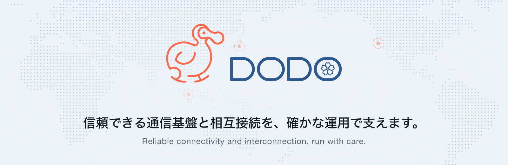</a>

  <a href="https://dodo.ad.jp/"><b>Web サイト</b></a> ·
  <a href="https://billing.dodo.ad.jp/">お申し込み</a> ·
  <a href="https://dodo.ad.jp/network/">ネットワーク</a> ·
  <a href="https://dodo.ad.jp/peering/">ピアリング</a> ·
  <a href="https://dodo.ad.jp/contact/">お問い合わせ</a> ·
  <a href="https://dodo.ad.jp/en/">English</a> ·
  <a href="https://dodo.ad.jp/zh/">中文</a>

  最新のニュースは SNS をご覧ください —
  <a href="https://line.me/R/ti/p/@195whzkt">LINE</a> ·
  <a href="https://www.facebook.com/people/DODO-KK/61596189341746/">Facebook</a> ·
  <a href="https://wa.me/818047736897">WhatsApp</a> ·
  <a href="https://x.com/dodokk_jp">X</a> ·
  <a href="https://t.me/dodonetofficial">Telegram</a>

## DODO株式会社について

DODO株式会社（DODO K.K.）は、インターネット接続、ネットワーク設計、システム構築、運用保守を一体で支える日本の通信事業者です（電気通信事業届出番号 A-04-20434）。東京、シンガポール、フリーモントの接続拠点と国内の主要 IX をつなぐ自社ネットワークで、**IP トランジット（BGP）**、**専用インターネット接続（DIA）**、**国際イーサネット専用線（IEPL）**、**コロケーション**、**専用サーバー・VPS**、**Mac mini / Mac Studio ホスティング**、**ASN・IP アドレス**、**ビジネスメール（迷惑メール対策）**、**Web サイト・システム開発**までをご提供しています。

- **24 時間 365 日の監視** — AI でネットワークを常に監視し、自動で復旧できない障害はオンコールエンジニアが対応します。
- **設計から運用まで一貫して** — ネットワーク、サーバー、ストレージを横断して、少人数の機動力のある体制で支えます。
- **IPv6 への取り組み** — IP トランジットをはじめ、IPv4 / IPv6 のデュアルスタックで接続をご提供しています（[詳しく](https://dodo.ad.jp/ipv6/)）。

## サービス

### 接続サービス

<table>
  <tr>
    <td width="50%" valign="top">
      <a href="https://dodo.ad.jp/services/ipt/">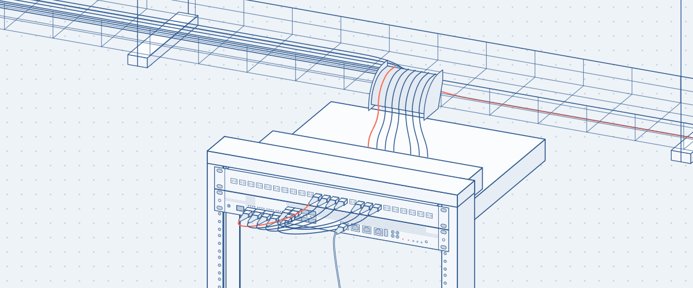</a>
      <h4><a href="https://dodo.ad.jp/services/ipt/">IP トランジット</a></h4>
      ISP・コンテンツ事業者向けの BGP 接続。国内外の主要キャリアをアップストリームとし、国内の主要 IX で経路を最適化します。 
      IP Transit
    </td>
    <td width="50%" valign="top">
      <a href="https://dodo.ad.jp/services/dia/">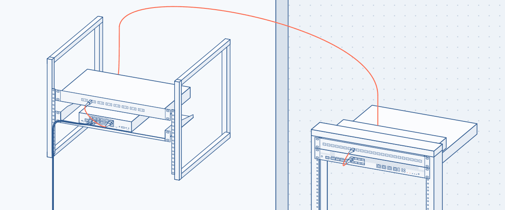</a>
      <h4><a href="https://dodo.ad.jp/services/dia/">専用インターネット接続（DIA）</a></h4>
      企業の拠点やサーバーのためのインターネット接続です。 
      Dedicated Internet Access
    </td>
  </tr>
  <tr>
    <td width="50%" valign="top">
      <a href="https://dodo.ad.jp/services/broadband/">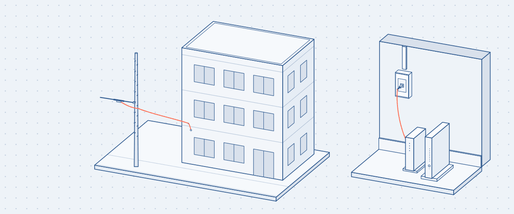</a>
      <h4><a href="https://dodo.ad.jp/services/broadband/">DODO光（法人向け）</a></h4>
      法人と集合住宅オーナーさま向けの光回線です。 
      DODO Hikari for business
    </td>
    <td width="50%" valign="top">
      <a href="https://dodo.ad.jp/home/gateway/">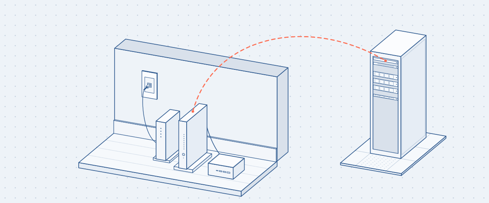</a>
      <h4><a href="https://dodo.ad.jp/home/gateway/">DODO ホームゲートウェイ</a></h4>
      今お使いの回線のまま、固定 IP と BGP が使えるトンネル接続です。 
      DODO Home Gateway
    </td>
  </tr>
</table>

### 拠点間接続

<table>
  <tr>
    <td width="50%" valign="top">
      <a href="https://dodo.ad.jp/services/iepl/">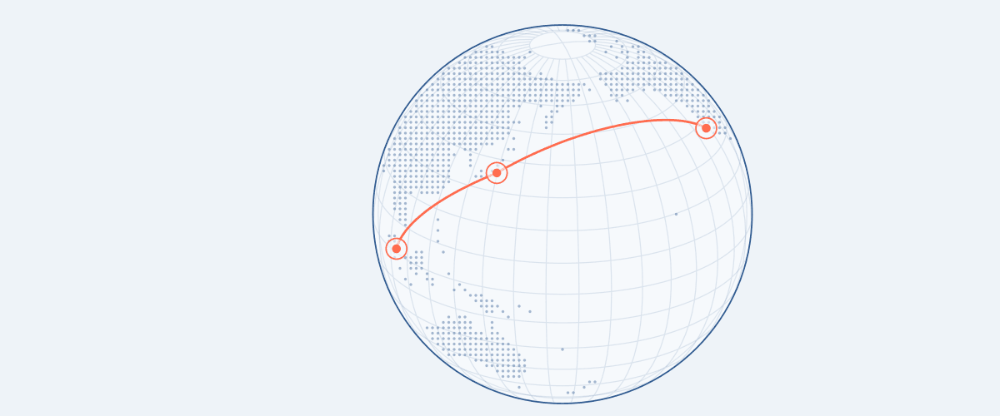</a>
      <h4><a href="https://dodo.ad.jp/services/iepl/">国際イーサネット専用線（IEPL）</a></h4>
      日本と海外の拠点を L2 で結ぶ国際イーサネット専用線です。 
      International Ethernet Private Line
    </td>
    <td width="50%" valign="top">
      <a href="https://dodo.ad.jp/services/site-link/">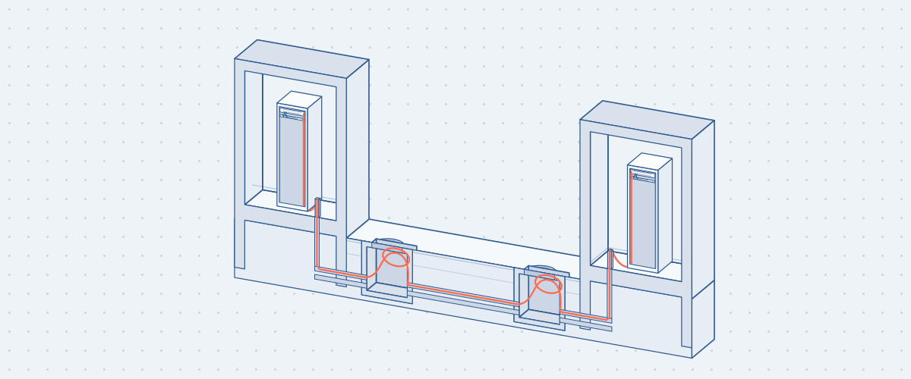</a>
      <h4><a href="https://dodo.ad.jp/services/site-link/">DODO サイトリンク</a></h4>
      拠点間を L2 のダークファイバーで接続します。 
      DODO Site Link
    </td>
  </tr>
</table>

### データセンター

<table>
  <tr>
    <td width="50%" valign="top">
      <a href="https://dodo.ad.jp/services/colocation/">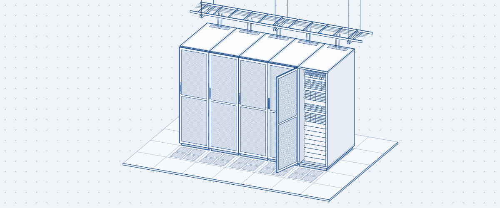</a>
      <h4><a href="https://dodo.ad.jp/services/colocation/">コロケーション</a></h4>
      サーバーやネットワーク機器をデータセンターでお預かりします。 
      Colocation
    </td>
    <td width="50%" valign="top">
      <a href="https://dodo.ad.jp/services/server-rental/">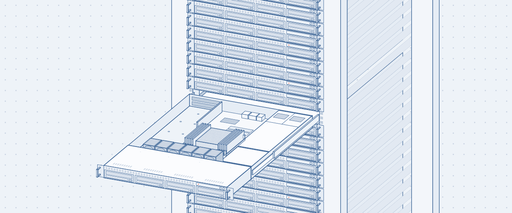</a>
      <h4><a href="https://dodo.ad.jp/services/server-rental/">サーバーレンタル</a></h4>
      AMD Ryzen™ 9 9950X と 64 コアの AMD EPYC™ を搭載した専用サーバーと VPS です。 
      Dedicated servers and VPS
    </td>
  </tr>
  <tr>
    <td width="50%" valign="top">
      <a href="https://dodo.ad.jp/services/mac-mini/">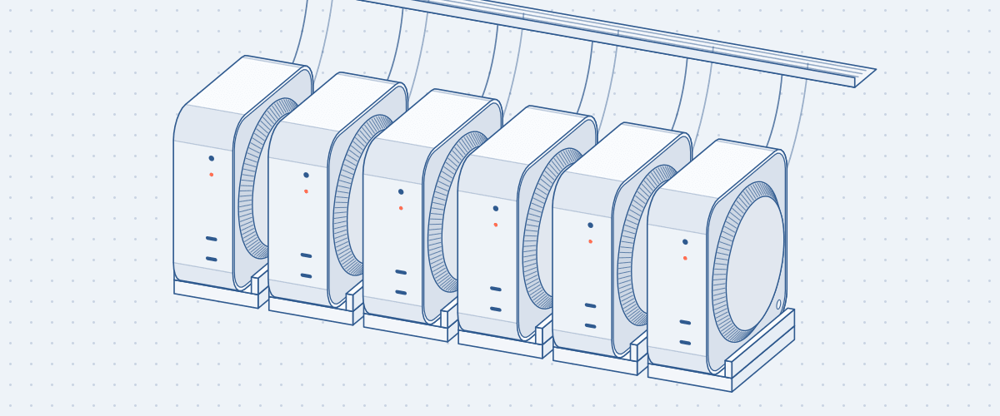</a>
      <h4><a href="https://dodo.ad.jp/services/mac-mini/">Mac mini / Mac Studio ホスティング</a></h4>
      お手持ちの Mac のお預かりと、当社の Mac mini のレンタル。月額 9,900 円（税込）から。 
      Mac hosting and rental
    </td>
    <td width="50%" valign="top">
      <a href="https://dodo.ad.jp/services/remote-hands/">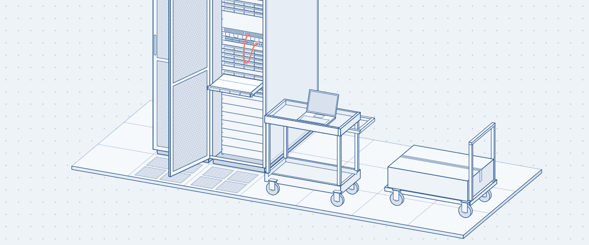</a>
      <h4><a href="https://dodo.ad.jp/services/remote-hands/">リモートハンズ</a></h4>
      データセンターでの物理作業を、当社のエンジニアが代行します。 
      Remote Hands
    </td>
  </tr>
</table>

### 番号資源・相互接続

<table>
  <tr>
    <td width="50%" valign="top">
      <a href="https://dodo.ad.jp/services/asn-ip-management/">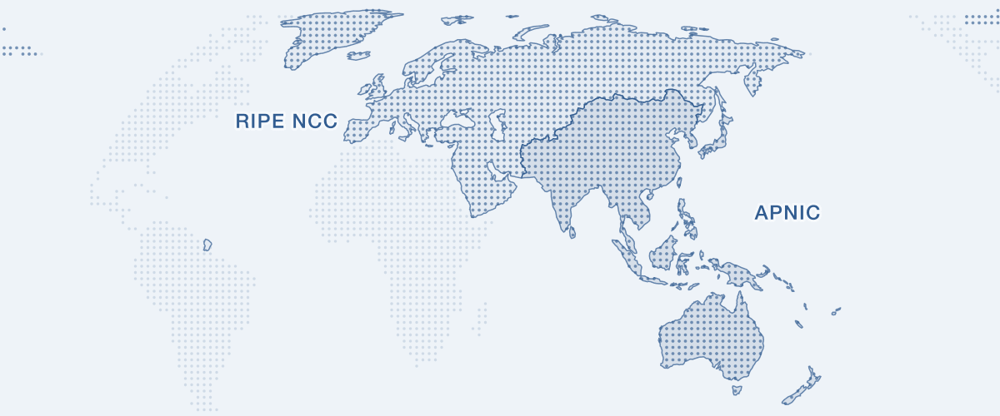</a>
      <h4><a href="https://dodo.ad.jp/services/asn-ip-management/">ASN / IP アドレス管理</a></h4>
      RIPE NCC と APNIC の番号資源で、ASN の登録と IP アドレスの貸与を支援します。 
      ASN and IP address management
    </td>
    <td width="50%" valign="top">
      <a href="https://dodo.ad.jp/services/academic-ix/">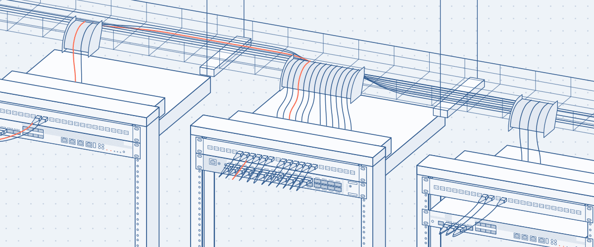</a>
      <h4><a href="https://dodo.ad.jp/services/academic-ix/">学術インターネット相互接続点</a></h4>
      教育・研究機関のための相互接続点（JEIX）のご案内と、接続のご相談を承ります。 
      Academic Internet Exchange
    </td>
  </tr>
</table>

### メール・開発

<table>
  <tr>
    <td width="50%" valign="top">
      <a href="https://dodo.ad.jp/services/mail/">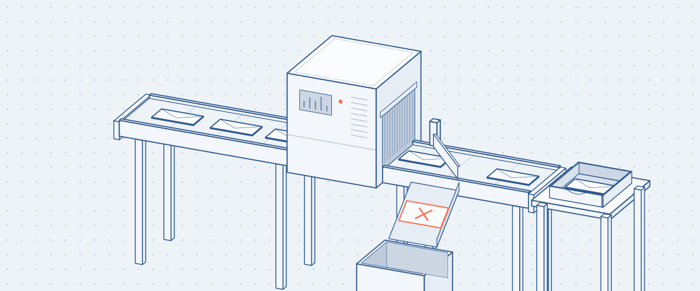</a>
      <h4><a href="https://dodo.ad.jp/services/mail/">ビジネスメール</a></h4>
      独自ドメインのメールと、Proxmox Mail Gateway に当社の独自ルールを重ねた迷惑メール対策。SMTP 認証、SPF・DKIM・DMARC、キャッチオールに対応します。 
      Business Email
    </td>
    <td width="50%" valign="top">
      <a href="https://dodo.ad.jp/services/web-development/">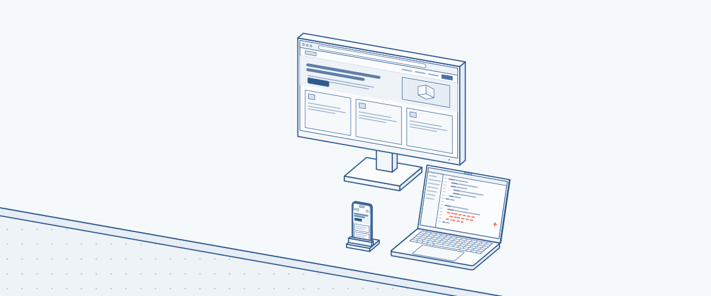</a>
      <h4><a href="https://dodo.ad.jp/services/web-development/">Web サイト・システム開発</a></h4>
      AI とエンジニアの技術を組み合わせ、Web サイトから業務システムまで、設計から公開後の運用まで承ります。 
      Website and system development
    </td>
  </tr>
</table>

## こんなときにご相談ください

| ご相談の内容 | サービス |
| --- | --- |
| BGP で IP トランジットを調達したい（IPv4 / IPv6） | [IP トランジット](https://dodo.ad.jp/services/ipt/) |
| 企業の拠点やサーバーに専用のインターネット接続がほしい | [専用インターネット接続（DIA）](https://dodo.ad.jp/services/dia/) |
| 今の回線のまま、固定 IP や BGP を使いたい | [DODO ホームゲートウェイ](https://dodo.ad.jp/home/gateway/) |
| 日本と海外の拠点を、インターネットを通さない L2 専用線で結びたい | [国際イーサネット専用線（IEPL）](https://dodo.ad.jp/services/iepl/) |
| データセンターにサーバーやネットワーク機器を置きたい | [コロケーション](https://dodo.ad.jp/services/colocation/) |
| AMD Ryzen 9 9950X や AMD EPYC の専用サーバー・VPS を日本で借りたい | [サーバーレンタル](https://dodo.ad.jp/services/server-rental/) |
| Mac mini や Mac Studio を東京のデータセンターで 24 時間動かしたい | [Mac ホスティング](https://dodo.ad.jp/services/mac-mini/) |
| データセンターでの機器交換や配線を代わりに頼みたい | [リモートハンズ](https://dodo.ad.jp/services/remote-hands/) |
| 自社の ASN を登録して、IPv4 / IPv6 アドレスを使いたい | [ASN / IP アドレス管理](https://dodo.ad.jp/services/asn-ip-management/) |
| 迷惑メールを減らしたい、独自ドメインのメールを使いたい | [ビジネスメール](https://dodo.ad.jp/services/mail/) |
| コーポレートサイトや業務システムを作りたい | [Web サイト・システム開発](https://dodo.ad.jp/services/web-development/) |

## ピアリング

国内外のネットワーク事業者さまとのピアリングを歓迎しています。ポリシーと申請方法は [ピアリングのページ](https://dodo.ad.jp/peering/) をご覧ください。申請は [ピアリングポータル](https://peering.dodo.ad.jp/) から受け付けています。

## English

DODO K.K. is a telecommunications carrier in Japan (notification no. A-04-20434) with points of presence in Tokyo, Singapore and Fremont. We provide:

- **IP transit** over BGP, IPv4 and IPv6 dual stack, and **dedicated internet access (DIA)**
- **International Ethernet private lines (IEPL)** and layer 2 dark fiber between sites
- **Colocation**, **dedicated servers and VPS** (AMD Ryzen 9 9950X, AMD EPYC) and **remote hands**
- **Mac mini and Mac Studio hosting** in a Tokyo data center, running 24/7
- **ASN and IP address management** (RIPE NCC, APNIC)
- **Business email** with spam filtering (Proxmox Mail Gateway), and **website and system development**

See [dodo.ad.jp/en](https://dodo.ad.jp/en/) for details, or [contact us](https://dodo.ad.jp/en/contact/).

## 简体中文

DODO株式会社是日本的电信运营商（电信业务申报编号 A-04-20434），在东京、新加坡和弗里蒙特设有接入点，提供日本 IP Transit（BGP，IPv4 / IPv6 双栈）、企业专用上网（DIA）、国际以太网专线（IEPL）、数据中心机柜托管、日本独立服务器与 VPS（AMD Ryzen 9 9950X、AMD EPYC）、东京数据中心的 Mac mini / Mac Studio 托管和 Mac mini 租用、远程协助（Remote Hands）、ASN 与 IP 地址管理（RIPE NCC、APNIC）、企业邮箱与反垃圾邮件（Proxmox Mail Gateway），以及网站与业务系统开发。详情请见 [dodo.ad.jp/zh](https://dodo.ad.jp/zh/)，或[联系我们](https://dodo.ad.jp/zh/contact/)。

---

  
    <a href="https://dodo.ad.jp/company/">会社概要</a> ·
    <a href="https://dodo.ad.jp/contact/">お問い合わせ</a> ·
    <a href="https://dodo.ad.jp/term/">利用規約</a> ·
    <a href="https://dodo.ad.jp/private/">個人情報について</a> 
    AMD、Ryzen、EPYC は Advanced Micro Devices, Inc. の、Mac、Mac mini、Mac Studio は Apple Inc. の、Proxmox は Proxmox Server Solutions GmbH の商標です。 
    © DODO株式会社
  

